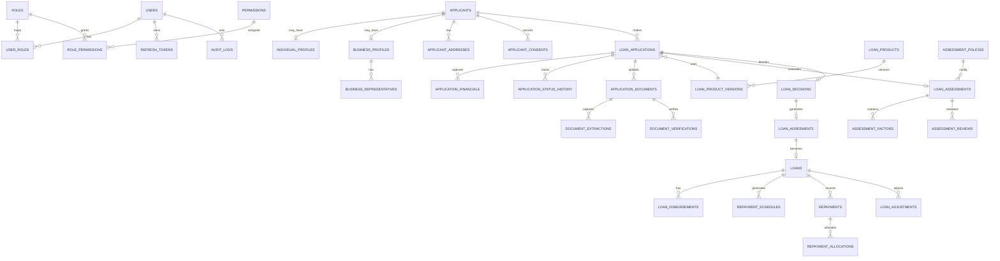

# Smart Loan Management System Design

## 1. Executive project overview

This system is a production-oriented web platform for lending institutions in Uganda that need to manage applicant onboarding, document collection, affordability assessment, approval, loan servicing, and repayment tracking. The platform is designed for both individual and business borrowers, with a shared application workflow and role-based access controls.

The architecture is intentionally split into a secure backend and a responsive frontend, with financial calculations implemented at the server side and treated as the authoritative source. The design prioritises explainability, auditability, data protection, and operational control.

### Confirmed requirements

- Web-based platform with Next.js frontend and Express backend.
- MySQL 8 InnoDB database with migration-based schema management.
- Multi-role access for applicants, officers, analysts, approvers, finance staff, auditors, and administrators.
- Support for both individual and business borrowers.
- UGX as the default currency, with designs that allow future multi-currency support.
- Explainable, rule-based loan assessment in version 1.
- Secure file handling, audit logging, and role restrictions.
- Loan lifecycle from application to repayment and closure.

### Assumptions requiring confirmation

1. Institution licence and regulatory category.
2. Product mix such as salary, SME, asset-backed, or working-capital loans.
3. Affordability policy thresholds and maximum debt-to-income ratios.
4. Late-payment penalties and legal treatment of fees.
5. Whether digital signatures are legally accepted for loan agreements.
6. Availability of credit bureau access and identity verification providers.
7. Document retention periods and data deletion policy.
8. Payment rails: mobile money, bank transfer, or both.
9. Internal approval limits by role and product.
10. Whether the institution has an internal compliance or risk committee.

### Recommended defaults

- Default product terms are configurable, not hard-coded.
- The system should enforce no final lending decision except by a human approver.
- Loan agreement acceptance must remain legally non-committal until the institution confirms acceptance requirements.
- All financial calculations are decimal-based and server-authoritative.

---

## 2. Functional requirements

### Core functions

- User authentication and session management.
- Applicant profile registration for individuals and businesses.
- Loan product catalog with versioned terms.
- Draft and submitted loan applications.
- Document upload, classification, review, and access logging.
- Rule-based affordability assessment.
- Approval, rejection, and additional-information workflow.
- Loan agreement generation and tracking.
- Disbursement processing with idempotency safeguards.
- Repayment recording, schedule generation, and allocation.
- Notifications and reports.
- Audit log review and secure system administration.

### Role-specific functions

#### Super Administrator

- User, role, and permission management
- Institution settings and configuration
- Product and policy management
- View system-wide analytics and audit trail

#### Loan Officer

- Applicant registration and data capture
- Application review and document checks
- Additional-information requests
- Workflow coordination

#### Credit Analyst

- Affordability assessment preparation
- Financial review and risk commentary
- Recommendation drafting

#### Loan Approver

- Final application decision
- Conditions, rejection reasons, and approval limits
- Review any concerns before approving

#### Finance Officer / Cashier

- Disbursement processing
- Payment reconciliation
- Financial statement support

#### Auditor

- Read-only access to audit logs, approvals, disbursements, and repayments

#### Applicant

- Registration, login, profile update, application submission
- Document upload and tracking
- Viewing loan offers and agreements
- Monitoring repayment schedule and statements

---

## 3. Non-functional requirements

- Secure by design and by default.
- Data integrity in financial processes through transactions.
- Explainable assessment logic and versioned rules.
- Auditability for approvals, disbursements, repayments, and configuration changes.
- High-quality response times for operational workflows.
- Accessibility for staff and applicants across responsive devices.
- Reliability with daily backups and recovery procedures.
- Maintainability through modular feature-based backend and UI architecture.
- Observability via structured logs, request correlation IDs, and health checks.

---

## 4. User roles and permission matrix

| Role | Core permissions | Constraints |
| --- | --- | --- |
| Super Administrator | System config, roles, loan products, reports, audit review | No direct override of financial transactions without approval workflow |
| Loan Officer | Register applicants, review applications, request info | Cannot approve or disburse |
| Credit Analyst | Review financials and produce assessment | Cannot final-approve |
| Loan Approver | Review and finalise decisions | Must remain within approval limits |
| Finance Officer | Disbursement and repayment reconciliation | Cannot modify assessment or approve own transactions |
| Auditor | Read-only analytics and audit logs | No write privileges |
| Applicant | Personal portal, application submission, documents, repayment visibility | Restricted to own records |

Recommended enforcement: use permissions at backend route level, not only in UI.

---

## 5. Applicant workflows

### Individual applicant workflow

1. Registration and email/phone verification.
2. Profile creation with identity, employment, and income details.
3. Select loan product and request amount.
4. Upload required documents.
5. Save draft or submit application.
6. Document review and request for more information.
7. Assessment generation.
8. Human review and approval or rejection.
9. Agreement acceptance if approved.
10. Disbursement.
11. Scheduled repayments and dashboard visibility.

### Business applicant workflow

1. Business registration and authorised representative setup.
2. Business profile with financial statements, ownership, and contact data.
3. Product selection and amount request.
4. Document submission and verification.
5. Cash-flow assessment based on operating financials.
6. E.g., review by analyst and approver.
7. Agreement, disbursement, and repayment management.

### Shared workflow principles

- No assessment result is a binding approval.
- Application stage transitions are versioned and logged.
- More information requests are recorded with timestamps and reasons.

---

## 6. Complete loan application lifecycle

Application statuses:

- DRAFT
- SUBMITTED
- DOCUMENT_REVIEW
- ASSESSMENT_PENDING
- UNDER_REVIEW
- MORE_INFORMATION_REQUIRED
- APPROVED
- REJECTED
- AGREEMENT_PENDING
- READY_FOR_DISBURSEMENT
- DISBURSED
- WITHDRAWN

Allowed transitions should be enforced by a status transition map and not by plain text updates.

Example model:

- DRAFT -> SUBMITTED
- SUBMITTED -> DOCUMENT_REVIEW
- DOCUMENT_REVIEW -> ASSESSMENT_PENDING
- ASSESSMENT_PENDING -> UNDER_REVIEW
- UNDER_REVIEW -> MORE_INFORMATION_REQUIRED
- MORE_INFORMATION_REQUIRED -> UNDER_REVIEW
- UNDER_REVIEW -> APPROVED
- UNDER_REVIEW -> REJECTED
- APPROVED -> AGREEMENT_PENDING
- AGREEMENT_PENDING -> READY_FOR_DISBURSEMENT
- READY_FOR_DISBURSEMENT -> DISBURSED
- any stage -> WITHDRAWN only if permitted by policy

---

## 7. Loan assessment methodology

### Assessment design

The first version uses a rule-based engine, not opaque scoring. It produces clear reasons, missing information, risk indicators, and recommended figures.

### Individual assessment inputs

- Verified monthly income
- Employment and income stability
- Reasonable household expenses
- Existing monthly obligations
- Disposable income
- Requested amount and proposed term
- Instalment affordability
- Document verification status

### Business assessment inputs

- Average monthly revenue
- Operating expenses and cash flow
- Existing business debt commitments
- Business operating period
- Financial statements and cash-flow quality
- Requested amount and term

### Disposable income formula

Disposable Income = Verified Monthly Income - Reasonable Monthly Expenses - Existing Monthly Debt Obligations

This is compared with the estimated repayment obligation under the proposed loan terms.

### Assessment outcomes

- ELIGIBLE_FOR_REVIEW
- ADDITIONAL_INFORMATION_REQUIRED
- MANUAL_REVIEW_REQUIRED
- NOT_WITHIN_CONFIGURED_AFFORDABILITY_POLICY

These are assessment statuses, not final approval outcomes.

---

## 8. Financial calculation methodology

### Decimal-safe rules

- Money is stored and processed as `DECIMAL(19,4)` in MySQL.
- Backend is the source of truth.
- Frontend displays are indicative only.
- Rounding is applied consistently at the final instalment or payment allocation stage using the institution's policy.

### Interest methods

#### Flat rate

Simple interest = Principal × Rate × Time

Total repayment = Principal + Interest

#### Reducing balance

Interest is charged on the outstanding balance, usually monthly.

If monthly rate is r and payment is P, the standard amortisation formula is:

P = L × [r(1 + r)^n] / [(1 + r)^n - 1]

where L = principal, r = monthly interest rate, n = number of instalments.

### Instalment calculation

- Monthly/weekly/biweekly instalment is calculated at the product policy level.
- Total repayment = sum of instalments plus eligible fees and charges.
- All fees, penalties, and interest are tracked separately from principal.

### Outstanding principal

Outstanding principal is the remaining amount due after prior principal allocations and adjustments.

### Partial payments

Partial repayment is allocated in order of:

1. Accrued charges and fees
2. Interest due
3. Principal due
4. Optional arrears or other contractual obligations

This allocation must be deterministic and auditable.

### Overpayments

Overpayments must be recorded as a separate credit or offset, not silently applied to future instalments without policy.

### Late charges

Late-payment charges are applied only where the loan terms or legal authority permit them. They must remain clearly separated from interest.

### Rounding policy

- All stored amounts use decimal-safe types.
- Final instalment adjustment is allowed only for the last scheduled instalment or any policy-defined rounding delta.
- The system must log the rounding adjustment with a rationale.

### Example

Assume principal = UGX 5,000,000, monthly rate = 2.5%, term = 12 months.

- Monthly instalment is calculated by amortisation formula.
- Total interest = total of all periodic interest components.
- Total repayment = principal + fees + interest + authorised charges

---

## 9. Database architecture and proposed tables

### Core tables

- users
- roles
- permissions
- user_roles
- role_permissions
- refresh_tokens
- applicants
- individual_profiles
- business_profiles
- business_representatives
- applicant_addresses
- applicant_consents
- loan_products
- loan_product_versions
- loan_applications
- application_financials
- application_status_history
- document_types
- application_documents
- document_extractions
- document_verifications
- document_access_logs
- loan_assessments
- assessment_factors
- assessment_policies
- assessment_reviews
- loan_decisions
- loan_agreements
- loans
- loan_disbursements
- repayment_schedules
- repayments
- repayment_allocations
- loan_adjustments
- notifications
- audit_logs
- system_settings
- file_access_logs

### Design principles

- UUIDs for identity across distributed records.
- InnoDB and foreign key constraints.
- UTC timestamps for all operations.
- `DECIMAL(19,4)` for money.
- Soft delete where appropriate, not for financial history.
- Historical versioning on loan products and assessment policies.

### Relationship priorities

- One applicant can have many loan applications.
- One application can have many documents and assessment records.
- One loan application can generate one final loan decision.
- One loan can have many disbursements and repayment schedules.
- One repayment can allocate across multiple obligations.
- Audit logs must remain append-only or highly protected.

---

## 10. ERD



---

## 11. Backend architecture and folder structure

```text
backend/
  src/
    config/
    database/
    migrations/
    seeds/
    common/
    errors/
    types/
    utils/
    constants/
    middleware/
    modules/
      auth/
      users/
      applicants/
      loan-products/
      applications/
      documents/
      assessments/
      approvals/
      agreements/
      loans/
      disbursements/
      repayments/
      notifications/
      reports/
      audit-logs/
    app.ts
    server.ts
  tests/
  .env.example
  package.json
  tsconfig.json
```

### Module responsibilities

- `controller`: HTTP handling only
- `service`: domain logic and transaction coordination
- `repository`: SQL and database-specific operations
- `schema`: request validation via Zod
- `types`: typed domain models
- `tests`: focused unit and integration coverage

---

## 12. Frontend architecture and folder structure

```text
frontend/
  app/
    (auth)/
    applicant/
    dashboard/
    admin/
    loans/
    applications/
    reports/
    settings/
    layout.tsx
    page.tsx
  components/
    ui/
    layout/
    shared/
  features/
    auth/
    applicants/
    applications/
    documents/
    assessments/
    approvals/
    loans/
    repayments/
    reports/
  hooks/
  lib/
  services/
  types/
  public/
```

### Portal division

- Applicant portal: registration, loan applications, document management, repayment status.
- Staff portal: dashboard, application queue, approval desk, disbursement, audit logs.

---

## 13. API endpoint catalogue

### Auth

- `POST /api/v1/auth/register`
- `POST /api/v1/auth/login`
- `POST /api/v1/auth/logout`
- `POST /api/v1/auth/refresh`
- `POST /api/v1/auth/forgot-password`
- `POST /api/v1/auth/reset-password`

### Users and permissions

- `GET /api/v1/users`
- `GET /api/v1/users/:id`
- `POST /api/v1/users`
- `PATCH /api/v1/users/:id`
- `GET /api/v1/users/roles`

### Applicants

- `GET /api/v1/applicants`
- `POST /api/v1/applicants`
- `GET /api/v1/applicants/:id`
- `PATCH /api/v1/applicants/:id`

### Loan products

- `GET /api/v1/loan-products`
- `POST /api/v1/loan-products`
- `GET /api/v1/loan-products/:id`
- `PATCH /api/v1/loan-products/:id`

### Applications

- `GET /api/v1/applications`
- `POST /api/v1/applications`
- `GET /api/v1/applications/:id`
- `PATCH /api/v1/applications/:id`
- `POST /api/v1/applications/:id/submit`

### Documents

- `POST /api/v1/documents/upload`
- `GET /api/v1/documents/:id`
- `DELETE /api/v1/documents/:id`
- `POST /api/v1/documents/:id/verify`

### Assessments

- `POST /api/v1/assessments/generate`
- `GET /api/v1/assessments/:id`
- `PATCH /api/v1/assessments/:id/override`

### Approvals

- `POST /api/v1/approvals/:applicationId/decide`
- `GET /api/v1/approvals/queue`

### Agreements

- `POST /api/v1/agreements/:loanId/generate`
- `PATCH /api/v1/agreements/:id/accept`

### Loans

- `GET /api/v1/loans`
- `GET /api/v1/loans/:id`
- `PATCH /api/v1/loans/:id`

### Disbursements

- `POST /api/v1/disbursements`
- `GET /api/v1/disbursements/:id`

### Repayments

- `POST /api/v1/repayments`
- `GET /api/v1/repayments/:id`
- `GET /api/v1/repayments/schedules/:loanId`

### Reports and notifications

- `GET /api/v1/reports/summary`
- `GET /api/v1/notifications`

All endpoints must enforce authentication and permissions and support consistent error responses.

---

## 14. Security architecture

### Controls

- JWT access tokens and secure refresh-token rotation
- bcrypt or Argon2 password hashing
- Helmet headers and CORS policies
- Rate limiting and brute-force protection
- Parameterised SQL queries and repository-layer validation
- File scanning integration point and signature validation
- Role-based access enforcement on the server
- IDOR protections by scoped lookup patterns
- Secure document storage with non-public identifiers
- Request correlation IDs and structured logs

### Additional security requirements

- No secrets committed to source code
- No sensitive values in logs
- Audit trail for privileged actions
- Strong password policy for staff accounts
- MFA for privileged roles if institution policy requires it

---

## 15. Data protection and ethical lending considerations

This project must comply with Uganda’s legal and institutional context, especially the Data Protection and Privacy Act, 2019, as applicable. No system can claim compliance by design alone. The institution must confirm its legal basis for processing personal and financial data, retention periods, and cross-border transfer policies.

### Ethical lending design

- Data minimisation and purpose limitation
- Transparency in application and decision process
- Human oversight for approval decisions
- No use of protected personal characteristics in affordability or approval decisions
- Clear explanation for rejection or additional information requests
- Right to access and correction as applicable in policy and law

---

## 16. Integration architecture

### External adapters

- Mobile money provider adapter
- Bank transfer adapter
- Email provider adapter
- SMS provider adapter
- OCR provider adapter
- Identity verification adapter
- Credit reference integration adapter

Each adapter should expose a consistent interface, with retry, idempotency, and webhook verification support.

---

## 17. Testing strategy

### Unit tests

- Affordability rules
- Flat-rate and reducing-balance calculations
- Repayment allocation logic
- Validation schemas
- Permission checks
- Status transitions

### Integration tests

- Repository and database validation
- Auth flow
- Application submission
- Document upload and review
- Approval workflow
- Disbursement and repayments

### API tests

- Success and error flows
- Unauthorised and forbidden access
- Duplicate and missing record handling
- Transaction rollback scenarios

### Security tests

- Forced browsing and privilege escalation
- SQL injection checks
- File upload validation
- Rate-limit verification

---

## 18. Deployment architecture

Recommended production deployment model:

- Frontend: Next.js in a container or managed Node environment
- Backend: Express + TypeScript microservice or monorepo service
- Database: managed MySQL or self-hosted MySQL with backups.
- Reverse proxy: Nginx or platform-native ingress
- TLS termination at edge or reverse proxy
- Secrets through environment management and secret vault
- CI/CD pipeline with linting, tests, and migrations

---

## 19. Implementation roadmap

### Phase 1 – Design and governance

- Confirm assumptions and regulatory context
- Finalise SRS and policy thresholds
- Define role matrix and workflows

### Phase 2 – Foundation

- Create monorepo, config, and environments
- Create MySQL schema and migration tooling
- Set up logging and error handling

### Phase 3 – Auth and user management

- Roles, permissions, login, and refresh tokens

### Phase 4 – Applicants and products

- Profiles, business records, products, application creation

### Phase 5 – Documents and assessment

- Secure uploads, verification, OCR hook, affordability engine

### Phase 6 – Approvals, agreements, and loans

- Decision workflow, agreement generation, disbursement and repayments

### Phase 7 – Reporting, notifications, and quality assurance

- Dashboards, exports, audit review, security validation

---

## 20. Risk register and mitigation

| Risk | Impact | Mitigation |
| --- | --- | --- |
| Regulatory ambiguity | High | Confirm with institution and legal adviser |
| Financial miscalculation | High | Server-side decimal calculations and tests |
| Security breach | High | Encryption, RBAC, secure storage, audits |
| Duplicate disbursement | High | Idempotency and transaction locks |
| Inaccurate document verification | Medium | Separate OCR and verification flows |
| Unclear business policy | Medium | Versioned policy tables and human review |

---

## 21. Acceptance criteria for the complete system

The system is acceptable when all of the following are true:

- Applicants can register, complete forms, upload documents, and track application status.
- Staff can review, assess, approve or reject applications with complete audit records.
- Approved loans can be disbursed and repayments managed securely.
- Financial calculations are decimal-safe, explainable, and verified by tests.
- Role restrictions are enforced server-side.
- Secure document storage and access control are in place.
- Reports and dashboards provide operational visibility without mixing operational and accounting data.
- The system supports future integration and policy versioning.

---

## 22. Recommended implementation status

This repository currently contains the initial production scaffolding and design reference, but the full business application, database schema, and advanced features should proceed only after review and approval of this design.
